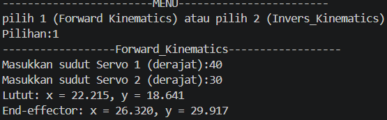
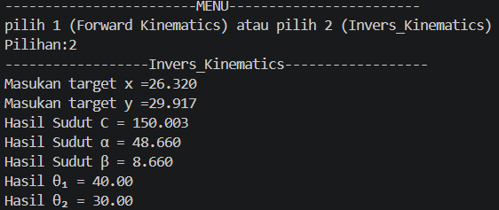
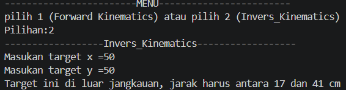

# # Forward dan Inverse Kinematics Kaki Robot 2 DoF

Penugasan Magang GMRT: menghitung posisi dan sudut servo kaki robot dengan Python.

## Profil
- **Nama:** Puji Kennard Manuel Simsanjuntak
- **NIM:** 25/556329/SV/25912

## Deskripsi
Program ini menghitung kinematika sebuah kaki robot 2 DoF yang terdiri dari Femur dan Tibia. Titik pusat koordinat (0,0) berada di sendi pangkal, dan panjang Coxa dianggap 0. Sudut positif berarti counter-clockwise (CCW), dengan posisi awal 0° saat lengan sejajar sumbu-X positif.

Panjang segmen ditentukan dari NIM:
- **Femur = 29 cm** (dua digit terakhir NIU 556329)
- **Tibia = 12 cm** (dua digit terakhir NIF 25912)

Saat dijalankan, program menampilkan menu dengan dua mode.

**Mode 1: Forward Kinematics (FK)** menghitung posisi dari sudut servo.
1. Pengguna memasukkan sudut Servo 1 (θ₁) dan Servo 2 (θ₂) dalam derajat.
2. Sudut diubah ke radian dengan `math.radians`.
3. Posisi lutut: `x1 = Femur · cos(θ₁)` dan `y1 = Femur · sin(θ₁)`.
4. Posisi end-effector: `x2 = x1 + Tibia · cos(θ₁+θ₂)` dan `y2 = y1 + Tibia · sin(θ₁+θ₂)`.

**Mode 2: Inverse Kinematics (IK)** menghitung sudut servo dari posisi target.
1. Pengguna memasukkan target (x, y) end-effector.
2. Jarak pangkal ke target: `c = √(x² + y²)`.
3. Hukum cosinus memberi sudut dalam segitiga di lutut (C), lalu `θ₂ = 180° − C`.
4. `α = atan2(y, x)` adalah arah target dari sumbu-X, dan `β` dicari dengan hukum cosinus di pangkal.
5. `θ₁ = α − β`.
6. Jika target di luar jangkauan (jarak harus antara 17 dan 41 cm), program menampilkan pesan dan tidak crash.

## Tabel Fitur

| Fitur | Jenis | Status |
|---|---|---|
| Forward Kinematics (input sudut, output posisi) | Tugas Wajib | ✅ |
| Mathematical Proof (coretan tangan rumus FK dan IK) | Nilai Tambah | ✅ |
| Inverse Kinematics (input target X, Y, output sudut) | Nilai Tambah | ✅ |
| N-DoF (lebih dari 2 DoF) | Nilai Tambah | ❌ |
| Spatial Kinematics 3D | Nilai Tambah | ❌ |
| Homogeneous Transformation Matrix (NumPy) | Nilai Tambah | ❌ |
| Visualisasi GUI/Plot (matplotlib) | Nilai Tambah | ❌ |

## Cara Penggunaan (How to Run)

**Kebutuhan:** Python 3. Program hanya memakai library `math` yang sudah bawaan Python, jadi **tidak ada library tambahan yang perlu di-install**.

**Menjalankan:**
```bash
python main.py
```

Lalu pilih mode: ketik `1` untuk Forward Kinematics atau `2` untuk Inverse Kinematics.

## Hasil Test Case

**Forward Kinematics** (θ₁ = 40°, θ₂ = 30°):

| Titik | x (cm) | y (cm) |
|---|---|---|
| Lutut | 22.215 | 18.641 |
| End-effector | 26.320 | 29.917 |



**Inverse Kinematics** (target x = 26.320, y = 29.917) menghasilkan θ₁ ≈ 40° dan θ₂ ≈ 30°, sesuai input FK sehingga kedua mode saling terbukti konsisten.



**Target di luar jangkauan** (contoh x = 50, y = 50) menampilkan pesan peringatan.



## Bukti Perhitungan Manual
Coretan tangan rumus dan perhitungan:
- 

## Struktur Repositori
```
├── main.py        # program FK dan IK
├── README.md
└── File_Pendukung/        # screenshot output dan foto coretan
```
